# Heart Disease Risk Prediction — End-to-End MLOps Report

**Course:** Machine Learning Operations (AIMLCZG523) — Assignment 01
**Project:** Scalable, reproducible ML solution for heart disease risk prediction
**Repository:** `https://github.com/2025ae05813-karan/mlops-assignment1`

---

## Table of Contents

1. Introduction & Objective
2. Setup & Installation
3. Dataset & Exploratory Data Analysis
4. Feature Engineering & Modeling
5. Experiment Tracking
6. Model Packaging & Reproducibility
7. CI/CD & Automated Testing
8. Containerization
9. Production Deployment
10. Monitoring & Logging
11. Architecture
12. Results Summary & Conclusion

---

## 1. Introduction & Objective

Cardiovascular disease is a leading cause of mortality, and early risk
identification supports timely clinical intervention. This project builds a
binary classifier that predicts the presence of heart disease from 13 routine
patient measurements, and — more importantly for this course — wraps that model
in a complete MLOps lifecycle: reproducible data processing, experiment
tracking, automated testing, CI/CD, containerized serving, Kubernetes
deployment, and monitoring.

The emphasis is on **production readiness**: every artifact is regenerated by
code, the pipeline fails loudly on errors, and the model serves identically in
an isolated container.

---

## 2. Setup & Installation

**Prerequisites:** Python 3.9+ (3.11 used in the container), optionally Docker
Desktop (with Kubernetes) or Minikube for deployment.

```bash
python3 -m venv .venv && source .venv/bin/activate
pip install -r requirements.txt            # or: conda env create -f environment.yml
```

Reproduce the full pipeline:

```bash
python scripts/download_data.py
python -m src.data_loader --sites cleveland
python -m src.eda
python -m src.train --mlflow
python -m src.mlflow_summary
```

Full details in `README.md` and `REPRODUCIBILITY.md`.

---

## 3. Dataset & Exploratory Data Analysis

**Source:** UCI Machine Learning Repository, Heart Disease dataset (ID 45),
Cleveland subset — **303 patients**, 13 features + target.

**Cleaning steps (`src/data_loader.py`):**
- The raw files are header-less and use `?` for missing values → converted to
  NaN and all columns coerced to numeric.
- The original target `num` is a 0–4 severity score → **binarized**: 0 = no
  disease, 1–4 = disease.
- Exact duplicate rows removed.
- Imputation/scaling are deliberately **not** done here; they live in the model
  pipeline (fit on training folds) to prevent data leakage.

**Resulting dataset:** 303 rows, 6 missing cells (in `ca`, `thal`), class
balance **164 no-disease / 139 disease** (~54% / 46%) — well balanced.

### Class balance
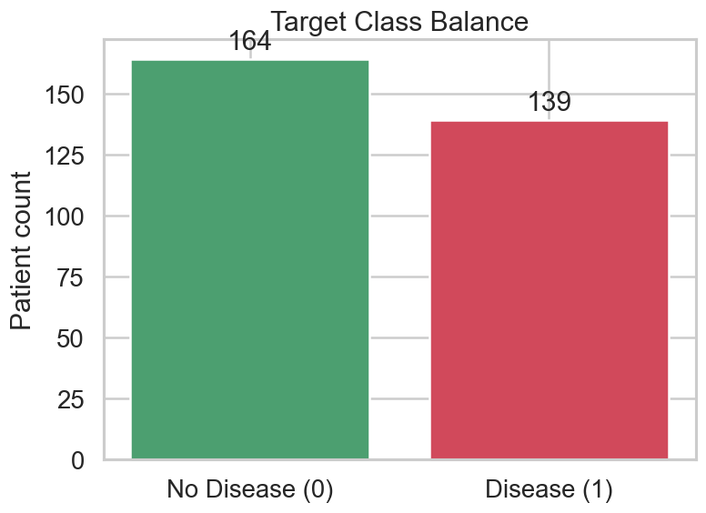

The near-even split means accuracy is a usable headline metric, but we still
report precision, recall, and ROC-AUC because recall (catching true cases) is
clinically most important.

### Numeric feature distributions
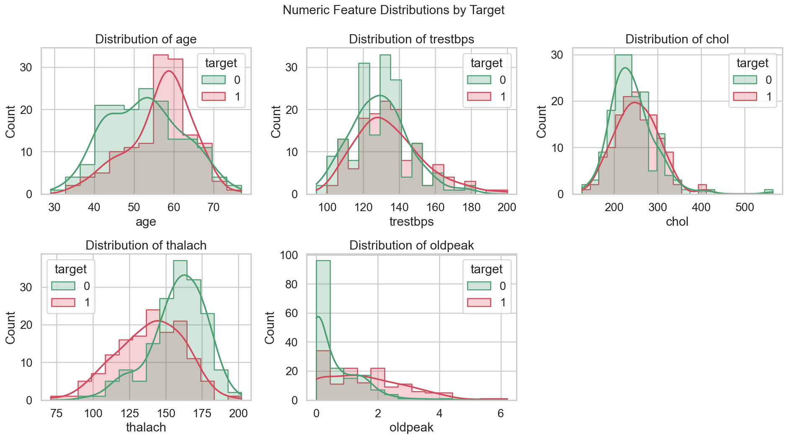

Diseased patients tend to show lower maximum heart rate (`thalach`) and higher
ST depression (`oldpeak`), consistent with clinical expectations.

### Categorical feature distributions
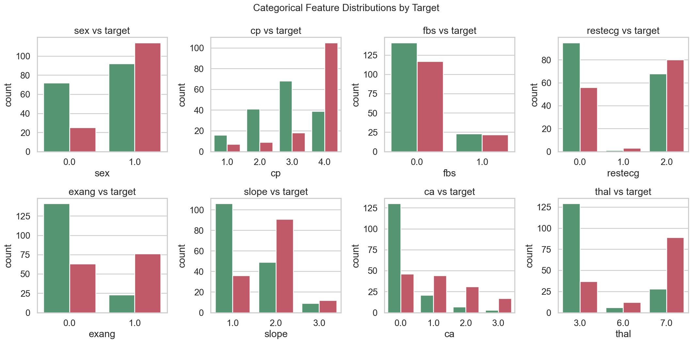

Chest-pain type (`cp`), exercise-induced angina (`exang`), number of major
vessels (`ca`), and `thal` separate the classes clearly.

### Correlation heatmap
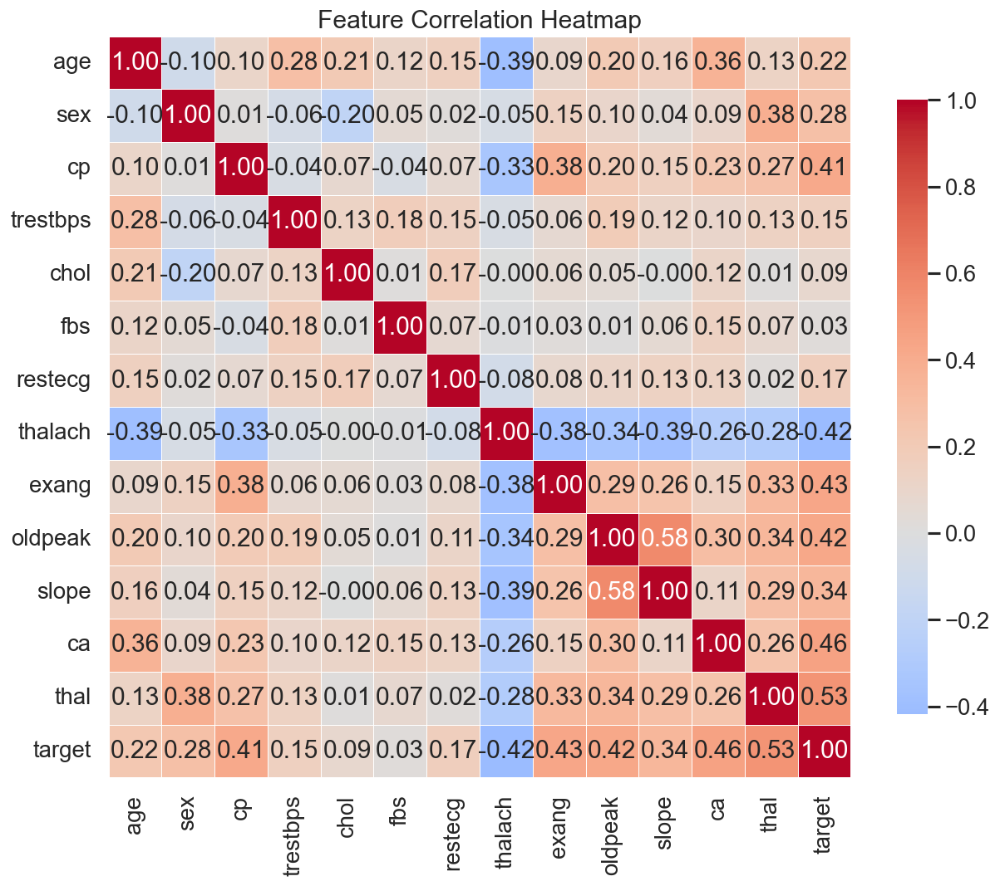

The strongest positive correlations with the target are `thal` (0.53),
`ca` (0.46), `exang` (0.43), and `oldpeak` (0.42); `thalach` is the strongest
negative (−0.42). No pair of predictors is collinear enough to require removal.

---

## 4. Feature Engineering & Modeling

### Preprocessing (`src/preprocess.py`)
A single scikit-learn `Pipeline` wraps a `ColumnTransformer`:
- **Numeric** (`age, trestbps, chol, thalach, oldpeak`): median imputation →
  standard scaling.
- **Categorical** (`sex, cp, fbs, restecg, exang, slope, ca, thal`):
  most-frequent imputation → one-hot encoding (`handle_unknown="ignore"`).

Bundling transforms into the pipeline guarantees that training and serving apply
identical logic and that statistics are learned only from training data.

### Models & tuning (`src/train.py`)
Two classifiers were trained and tuned with **`GridSearchCV` + 5-fold stratified
cross-validation**, scoring on ROC-AUC:

| Model | Search space |
|-------|--------------|
| Logistic Regression | `C ∈ {0.01, 0.1, 1, 10}`, solvers `{lbfgs, liblinear}` |
| Random Forest | `n_estimators ∈ {200, 400}`, `max_depth ∈ {None, 5, 10}`, `min_samples_leaf ∈ {1, 2, 4}` |

Data was split 80/20 (stratified, seed 42). Each tuned model was evaluated on
the held-out 61-row test set.

### Results

| Model | CV ROC-AUC | Test Acc | Precision | Recall | F1 | Test ROC-AUC |
|-------|-----------|----------|-----------|--------|-----|--------------|
| **Logistic Regression** (selected) | **0.9025** | 0.8852 | 0.8387 | 0.9286 | 0.8814 | 0.9665 |
| Random Forest | 0.8996 | 0.8525 | 0.8065 | 0.8929 | 0.8475 | 0.9545 |

**Selection:** Logistic Regression was chosen on the highest cross-validated
ROC-AUC. It also delivers the best recall (0.93) — the priority for a screening
model — while remaining interpretable.

### Diagnostics
| Logistic Regression | Random Forest |
|---------------------|---------------|
| 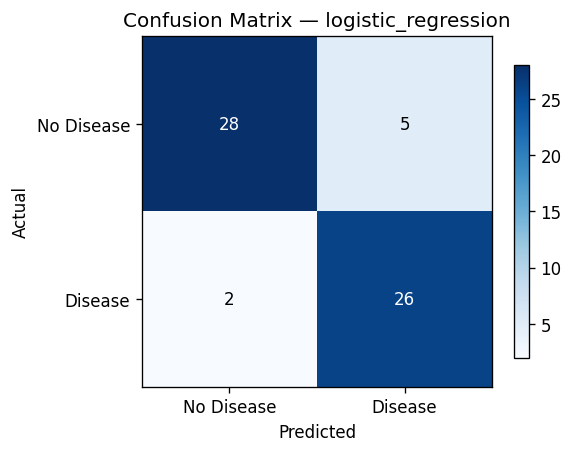 | 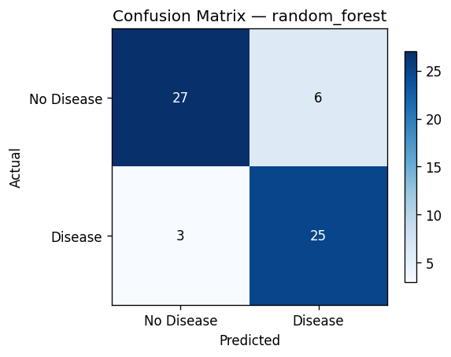 |
| 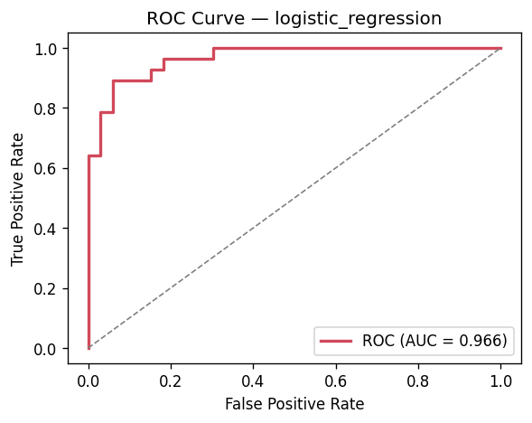 | 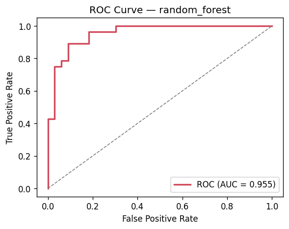 |

---

## 5. Experiment Tracking

MLflow logs every run under the `heart-disease-classification` experiment. Each
run records hyperparameters, the six metrics above, and artifacts (confusion
matrix, ROC curve, and the serialized model). A text summary is exported to
`report/experiment_tracking_summary.md`.

View the UI with:
```bash
mlflow ui --backend-store-uri ./mlruns   # http://127.0.0.1:5000
```

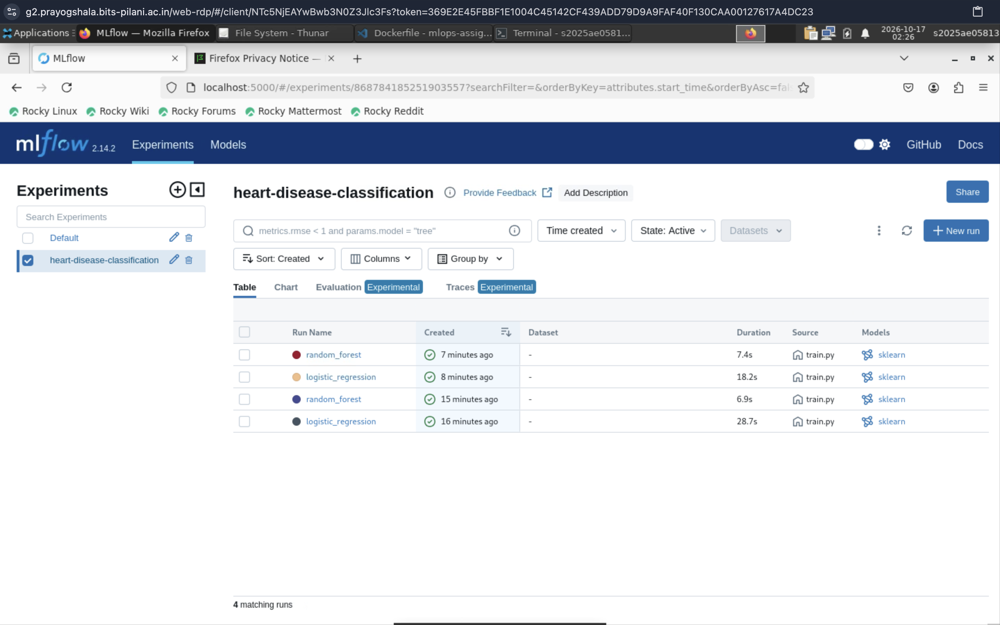

The `heart-disease-classification` experiment shows all tuned runs (Logistic
Regression and Random Forest), each logged from `train.py` with its parameters,
metrics, and the serialized sklearn model.

---

## 6. Model Packaging & Reproducibility

- **Artifact:** `models/model.joblib` — the full preprocessing + model pipeline,
  serialized with joblib. `models/model_metadata.json` records the selected
  model, tuned params, feature schema, seed, and all candidate metrics.
- **Dependencies:** pinned in `requirements.txt` (and `environment.yml`).
- **Verification:** a clean virtual environment was created, dependencies
  installed solely from `requirements.txt`, and the full pipeline re-run — it
  reproduced the exact metrics and sample prediction. See `REPRODUCIBILITY.md`.

---

## 7. CI/CD & Automated Testing

**Tests (`tests/`, 26 total):**
- `test_data.py` (11) — raw loading, `?`→NaN, target binarization, dedupe,
  feature split, imputation, scaling, full-pipeline fit/predict.
- `test_model.py` (7) — ≥2 models present, valid grids, metric correctness,
  estimator learning, `predict_proba` availability.
- `test_api.py` (8) — health, predict (prediction + confidence), input
  validation (422), metrics endpoint.

**Pipeline (`.github/workflows/ci.yml`):** three gated jobs —
`lint (ruff)` → `test (pytest + JUnit)` → `train (MLflow + artifact uploads)`.
The pipeline **fails on any lint or test error** (verified non-zero exit codes)
and uploads the test report, model, plots, and MLflow runs as artifacts.

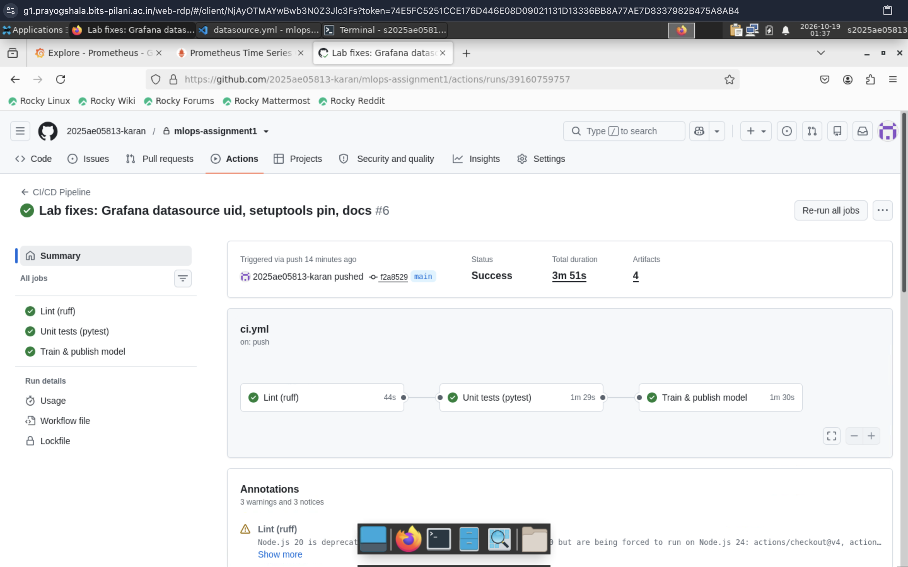

A successful run of the pipeline on `main`: all three jobs — Lint (ruff), Unit
tests (pytest), and Train & publish model — pass, producing four uploaded
artifacts.

---

## 8. Containerization

`Dockerfile` builds a `python:3.11-slim` image that installs dependencies,
builds the dataset, **trains the model at build time** (fully self-contained),
runs as a non-root user, and defines a container `HEALTHCHECK` against
`/health`. The API serves via uvicorn on port 8000.

Build & test:
```bash
docker build -t heart-disease-api:latest .
bash scripts/docker_build_and_test.sh
```

**Image build (16/16 layers, self-contained):**

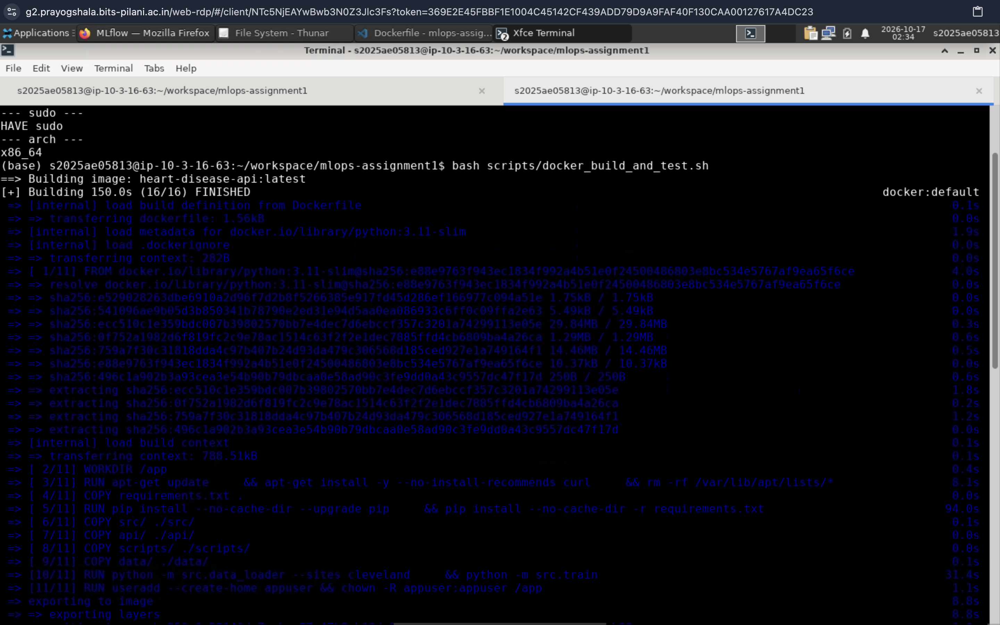

**Container health and predictions** — the helper script hits `/health`, then
posts a low-risk and a high-risk sample. The low-risk patient returns
`no_disease` (confidence 0.83) and the high-risk patient returns `disease`
(confidence 0.986):

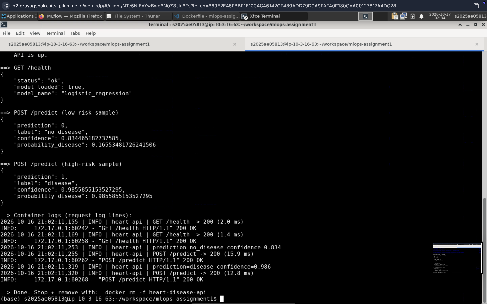

**Request logs from inside the container** (method, path, status, latency, plus
prediction label and confidence):

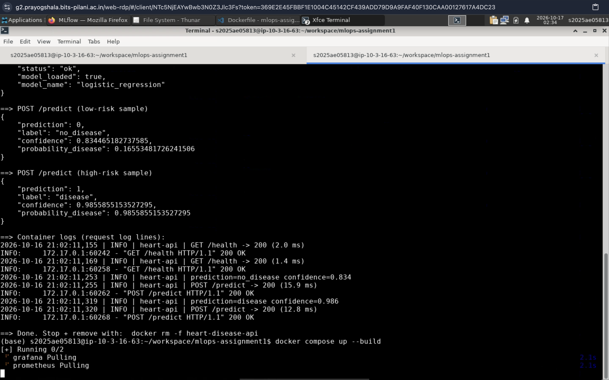

---

## 9. Production Deployment

Deployed to **local Kubernetes** (Minikube or Docker Desktop) via manifests in
`deploy/k8s/`:
- **Deployment** — 2 replicas, readiness + liveness probes on `/health`,
  CPU/memory requests & limits.
- **Service** — `LoadBalancer` (port 80 → 8000). An **Ingress** manifest is
  provided as an alternative.

```bash
bash scripts/k8s_deploy_and_verify.sh
```

**Cluster state** — the Deployment reports 2/2 ready replicas, both pods are
`Running`, and the `LoadBalancer` Service exposes the API (port 80 → NodePort
32287):

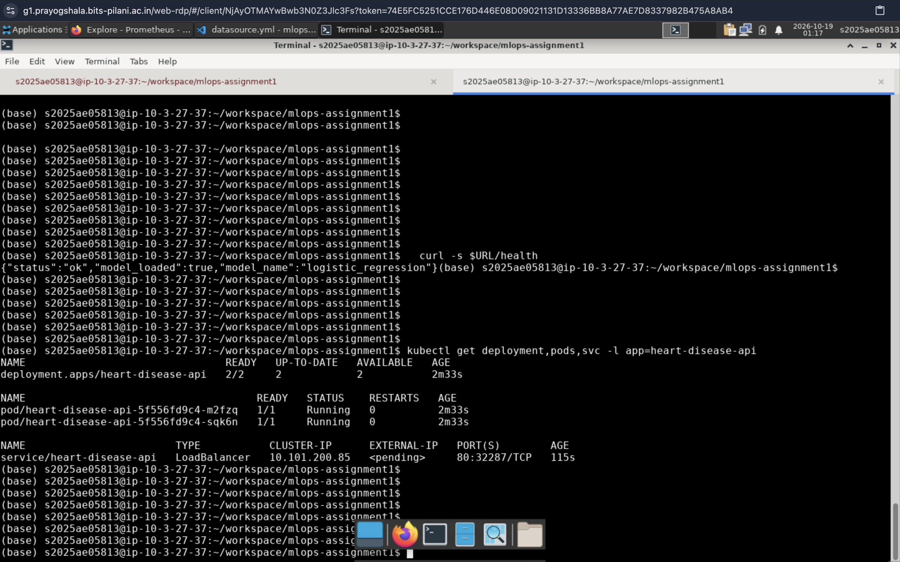

**Endpoint verification against the cluster** — `curl $URL/health` returns the
loaded model, and `curl $URL/predict` returns a `disease` prediction with 0.986
confidence:

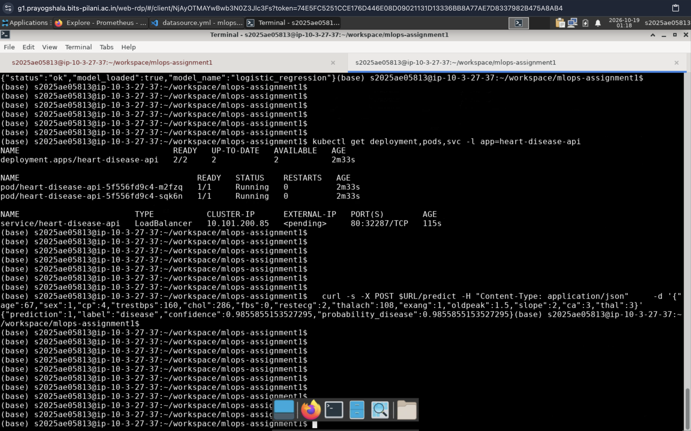

**Deployment detail** (`kubectl describe`) — RollingUpdate strategy, liveness &
readiness probes on `/health`, and CPU/memory requests and limits:

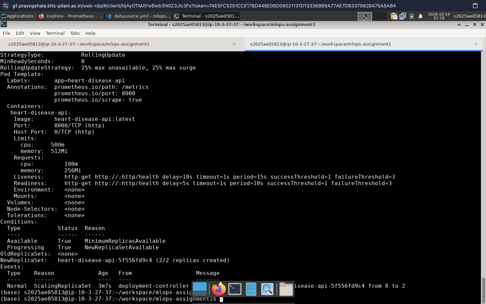

See `deploy/k8s/README.md` for the full flow.

---

## 10. Monitoring & Logging

- **Logging:** middleware logs method, path, status, and latency for every
  request, plus prediction label and confidence.
- **Metrics:** the API exposes Prometheus metrics at `/metrics`.
- **Stack:** `docker compose up --build` runs API + Prometheus + Grafana.
  Grafana auto-provisions the Prometheus datasource and a dashboard with
  request rate, status codes, latency p50/p95, predict count, and average
  duration.

**Prometheus targets** — both the API and Prometheus itself are scraped and
`UP`:

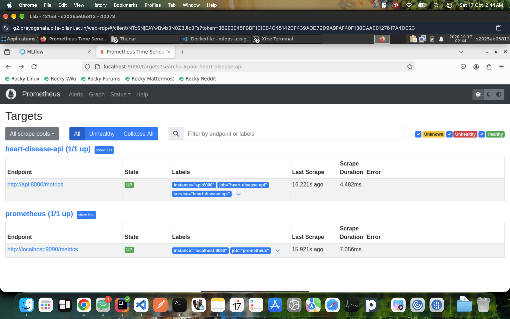

**Prometheus query** — `http_requests_total` broken down by handler after a
load-generation loop (`/health`, `/metrics`, and 100 `/predict` calls):

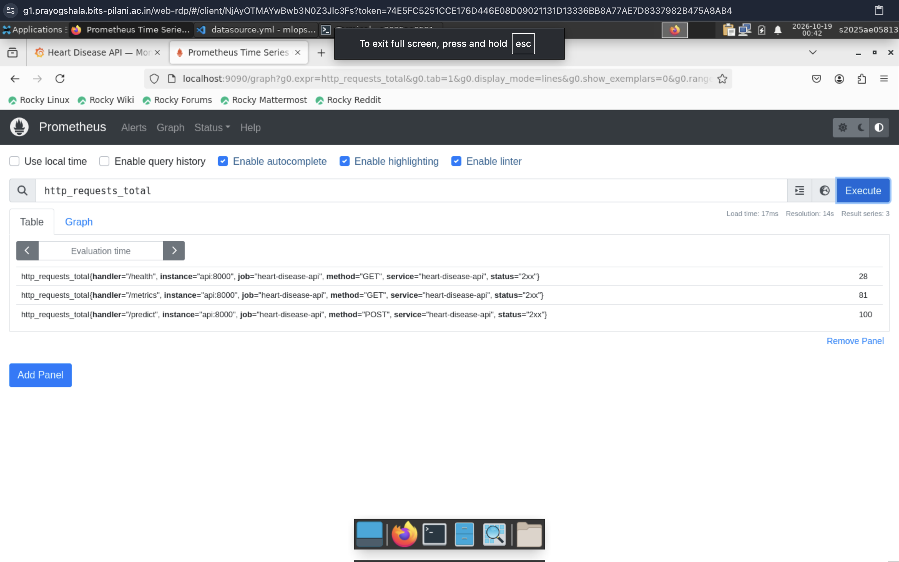

**Grafana dashboard** — request rate by handler, responses by status code,
latency p50/p95, total `/predict` requests, and average request duration, all
updating live:

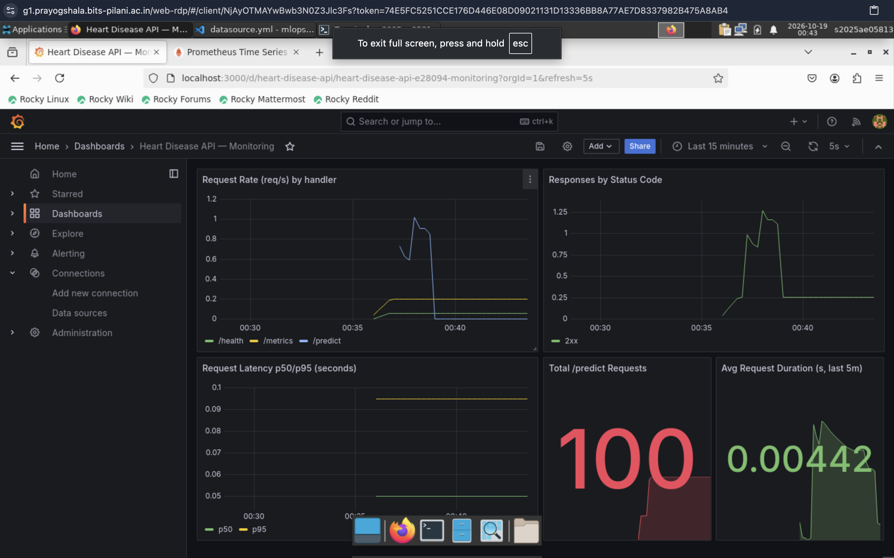

See `deploy/monitoring/README.md`.

---

## 11. Architecture

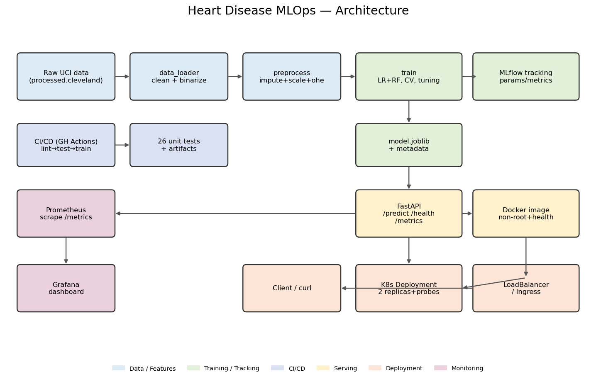

The same Docker image flows from CI through serving, deployment, and monitoring.
A detailed component breakdown and the Mermaid source are in
`report/architecture.md`.

---

## 12. Results Summary & Conclusion

| Assignment task | Status |
|-----------------|--------|
| 1. Data & EDA | Clean pipeline + 4 professional visualizations |
| 2. Modeling | LR + RF, CV + tuning, full metric suite |
| 3. Experiment tracking | MLflow runs with params/metrics/artifacts |
| 4. Packaging & reproducibility | Pipeline artifact, pinned deps, clean-env verified |
| 5. CI/CD & tests | 26 tests, 3-stage GitHub Actions, fail-on-error |
| 6. Containerization | Self-contained Dockerfile + `/predict` + confidence |
| 7. Deployment | K8s Deployment + LoadBalancer/Ingress |
| 8. Monitoring | Prometheus + Grafana + request logging |
| 9. Documentation | This report, README, architecture, guides |

**Final model:** Logistic Regression — Test ROC-AUC **0.966**, Recall **0.93**,
Accuracy **0.885**.

**Conclusion.** The project delivers a reproducible, testable, and observable ML
service that mirrors a real production workflow. The modular design (clean
separation of data, training, serving, and ops) means each piece is independently
verifiable, and the local-first deployment keeps the entire stack reproducible at
no cloud cost while remaining portable to a managed cluster.

---

*Screenshots referenced above (MLflow UI, GitHub Actions, Docker, kubectl,
Prometheus/Grafana) are captured during the local run and stored in
`report/screenshots/`.*
