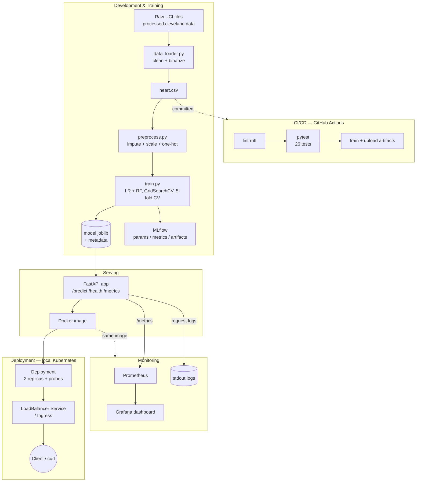

# Architecture

## End-to-end pipeline



## Component responsibilities

| Layer | Component | Responsibility |
|-------|-----------|----------------|
| Data | `src/data_loader.py` | Parse raw UCI, handle `?`→NaN, binarize target, dedupe |
| Features | `src/preprocess.py` | Leakage-safe ColumnTransformer inside a Pipeline |
| Training | `src/train.py` | Tune LR + RF with CV, select best, persist pipeline + metadata |
| Tracking | MLflow | Log params, metrics, plots, and the model for every run |
| Serving | `api/main.py` | Validate input, predict + confidence, expose health/metrics |
| Packaging | `Dockerfile` | Self-contained image (trains at build), non-root, healthcheck |
| CI/CD | `.github/workflows/ci.yml` | lint → test → train; fails on error; uploads artifacts |
| Deployment | `deploy/k8s/*` | 2-replica Deployment, LoadBalancer/Ingress, health probes |
| Monitoring | `deploy/monitoring/*` | Prometheus scrape + Grafana dashboard; request logging |

## Key design decisions

1. **Single serving artifact.** Preprocessing and the estimator are one sklearn
   `Pipeline`, so training and inference apply identical transforms — no
   training/serving skew.
2. **No data leakage.** Imputation and scaling are fit only on training folds.
3. **Reproducibility first.** Fixed seeds, pinned dependencies, and a
   clean-environment verification that reproduces the exact metrics.
4. **Fail-fast CI.** Lint and tests gate training; non-zero exit codes stop the
   pipeline with clear logs.
5. **Local-first, cloud-ready.** Everything runs on Minikube/Docker Desktop for
   free; the same manifests/image deploy to a managed cluster unchanged.
```
